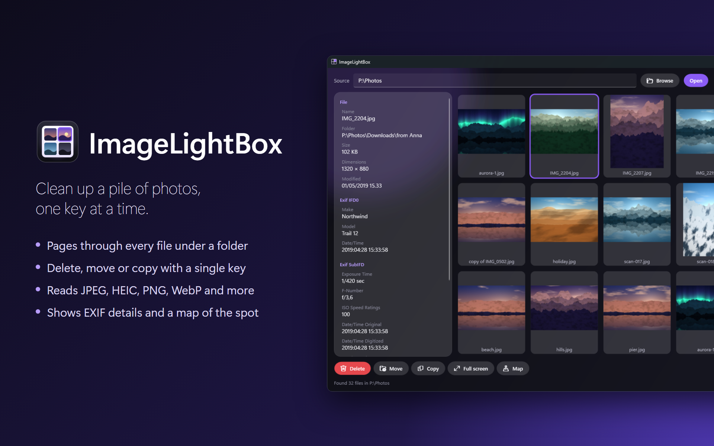

# ImageLightBox

[](https://github.com/kreaton/ImageLightBox/releases/latest)
[](LICENSE)




**Clean up a pile of photos fast.**

Page through thumbnails of every file under a folder, and delete, move or copy as you go.

## Install

**[Download the installer](https://github.com/kreaton/ImageLightBox/releases/latest/download/ImageLightBox-win-Setup.exe)** and run it. If your PC doesn't have the .NET 10 Desktop Runtime yet, the installer adds it.

The installer isn't code-signed, so Windows may warn you about it. To continue, choose **More info → Run anyway**.

To get a newer version later, click the ⓘ button and choose **Check for updates**. To remove the app, use **Settings → Apps → Installed apps** in Windows.

## Using it

Enter a source folder and press Enter. Files show up while the scan runs, sorted like Explorer, one folder at a time with subfolders after it.

JPEG, HEIC, PNG, GIF, BMP, TIFF and WebP files show as pictures. Anything else, such as a `.mov`, gets an icon with its type and file name, and can be deleted, moved or copied just the same.

Left-click selects a file and shows its EXIF on the left, or for a movie its duration, size and camera details. Right-click gives the same actions as the buttons. After a delete or move the next file moves into its place and is selected, ready for the next decision.

| Key | Action |
| --- | --- |
| Page Up, Page Down, mouse wheel | Previous, next page |
| Home, End | First, last page |
| Arrow keys | Move the selection, across pages too |
| Delete | Delete |
| M | Move to a folder |
| C | Copy to a folder |
| Enter or double-click | Full screen, or play a video |
| L | Show the location on a map |
| Esc | Deselect, or leave full screen |

In full screen, the arrow keys step through files, and Delete, M, C and L work the same.

## The map

Map, on the button or the right-click menu, is available for a file with a GPS position: most phone photos, and iPhone movies. It opens OpenStreetMap in a small window, which keeps following the selection until you close it, without reloading. Closing it only hides it, so it opens again at once.

Map tiles come from openstreetmap.org, so which part of the map you're looking at goes there, but only while the map window is open. **Check for updates** contacts GitHub when you choose it. Nothing else leaves the PC. The window needs the WebView2 runtime that comes with Windows 11, and without it the map opens in your browser. The map page itself is drawn by [Leaflet](https://leafletjs.com) 1.9.4, in `ImageLightBox.Wpf\Map`.

If the page hasn't loaded after 15 seconds, the window offers to open the place in your browser instead. Each loading stage is timed in `%LOCALAPPDATA%\ImageLightBox\map.log`, which never holds a location.

## Videos

Enter, double-click, and the button and menu item that say Play for a video all open it in its default player. Other files that aren't images only get their icon.

## Good to know

- **Thumbnail size.** Standard always fits four images, following the window size. The fixed sizes fit as many as the window has room for.
- **Delete goes to the Recycle Bin**, also with confirmation turned off. Folders without a Recycle Bin, such as most network shares, delete for good.
- **Nothing gets overwritten.** The scan is recursive, so names often clash when moving into one folder: the later one becomes `name (1).jpg`.
- **Holding a key down doesn't repeat** delete, move or copy, so a stuck key can't run through a folder.
- **HEIC needs nothing from the Microsoft Store.** Magick.NET decodes it, at the price of about 25 MB of native code. A HEIC decodes in full even for a thumbnail, so these are slower than JPEGs, which WIC scales while decoding.
- **Paging is instant once decoded.** Up to 1 GB of images stays in memory, and the pages around the current one load ahead of time.
- **Hidden and system files and folders are skipped**, and so are symlinks and junctions, which can loop.
- Settings live in `%LOCALAPPDATA%\ImageLightBox\settings.json`.

## Credits

Made by Per Hejndorf, with Claude (Anthropic). The same credits are on the About card, behind the info button at the top right.

- [MetadataExtractor](https://github.com/drewnoakes/metadata-extractor-dotnet) by Drew Noakes (Apache-2.0), for EXIF and movie metadata
- [Magick.NET](https://github.com/dlemstra/Magick.NET) by Dirk Lemstra (Apache-2.0), for HEIC
- [Leaflet](https://leafletjs.com) by Volodymyr Agafonkin (BSD-2-Clause), for the map page
- Map data © [OpenStreetMap](https://www.openstreetmap.org/copyright) contributors
- WebView2 by Microsoft, for the map window
- Segoe Fluent Icons by Microsoft
- [Velopack](https://velopack.io), for installs and updates

© 2026 Per Hejndorf

---

## For developers

| Project | Description |
| --- | --- |
| `ImageLightBox.Core` | Scanning, file actions, grid maths and EXIF, with no UI |
| `ImageLightBox.Wpf` | The app, built with WPF's Fluent theme in dark and styled like Mp3Player |
| `ImageLightBox.Tests` | xUnit tests of the core |

### Build and run

You need the [.NET 10 SDK](https://dotnet.microsoft.com/download).

```bash
dotnet run --project ImageLightBox.Wpf
```

```bash
dotnet test ImageLightBox.Tests
```

### Releases

Every push to `main` runs the tests, builds the app on GitHub Actions and publishes a new release, one patch version higher than the last (`.github/workflows/release.yml`). To push without releasing, add `[skip ci]` to the commit message. You can also start a release by hand from the repository's Actions tab, or run `ImageLightBox.Wpf\BuildRelease.ps1` locally. Add `-LocalOnly` to build without uploading.

The repository must stay public, because **Check for updates** reads its releases without logging in.
